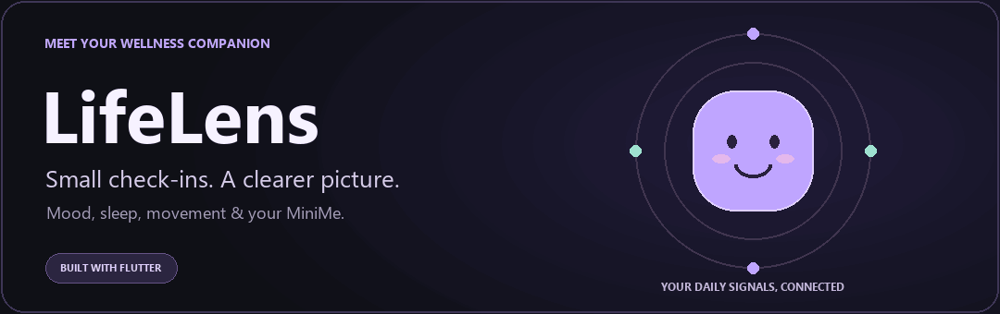
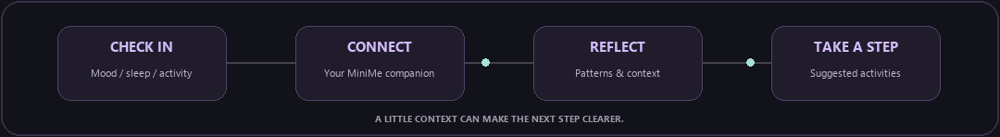
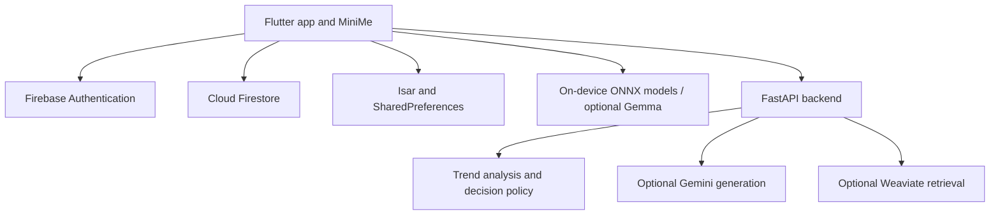

<div align="center">



# Your day, through a clearer lens.

**Track how you feel. Notice your patterns. Meet your MiniMe.**

<p>
  
  
  
  
  
</p>

[Explore the features](#what-the-app-includes) &nbsp; · &nbsp; [Run locally](#local-setup) &nbsp; · &nbsp; [See the architecture](#architecture) &nbsp; · &nbsp; [Project boundaries](#current-boundaries)

</div>

---

## A companion for everyday check-ins

LifeLens is a Flutter wellness companion that brings mood, sleep, symptom, and exercise logs together around a customizable **MiniMe** avatar. The app uses recent check-ins to build personal insights, suggest activities, and provide a conversational companion. A Python FastAPI backend supports chat, recommendations, trend analysis, and optional retrieval from a Weaviate knowledge base.

This repository contains the mobile app, backend services, bundled ONNX models, and experimental summarization and evaluation tools. It is a development project: some integrations need configuration, and some model pipelines are separate from the tracking screens currently exposed in the app.



### Built around you

| Your daily check-in | Your MiniMe | Your next step |
| :--- | :--- | :--- |
| Log mood, sleep, symptoms, and exercise in one place. | Customize your companion and chat with context from recent logs. | Explore personal insights, activity suggestions, and community spheres. |

## What the app includes

| Area | Implemented behavior |
| --- | --- |
| **Accounts and onboarding** | Firebase email/password authentication, email verification, password recovery, and a profile onboarding flow. |
| **MiniMe companion** | A customizable avatar, conversation history, contextual suggestions, and visual responses to the user's wellness state. |
| **Mood check-ins** | Mood selection, intensity, notes, tags, saved drafts, and log history. |
| **Sleep tracking** | Bedtime, wake time, sleep quality, history, and sleep insights. |
| **Symptom tracking** | Free-text symptom entry, keyword-based detection, local history, and cloud sync attempts. The current screen saves tracking entries without running the diagnostic model pipeline. |
| **Exercise** | A Firestore-backed exercise catalog with search and filters, favorites, exercise logs, and context-based recommendations. |
| **Personal insights** | Backend analysis of sleep, mood, exercise, and symptom counts, including trends, confidence, explanatory signals, and suggested actions. |
| **Community spheres** | Topic groups with membership, posts, replies, reactions, pinned content, reporting, and moderation-related client flows. |
| **Preferences** | Profile and avatar settings, calm theme mode, and configurable tracking reminders. |
| **Health imports** | Apple Health / Android Health Connect integration for available health metrics, subject to device support, permission grants, and existing health data. |

After signing in and verifying an email address, users complete onboarding and enter four main areas: **MiniMe**, the **log hub**, **Community**, and **Profile**.

## Architecture



- **Flutter / Dart:** Material UI, Provider state management, avatar assets, and native integrations.
- **Firebase:** Authentication and cloud data for profiles, sleep, community, exercises, and selected tracking records.
- **Local storage:** Isar collections for mood, symptom, fitness, end-of-day, and chat records; SharedPreferences for settings, drafts, avatar selections, and exercise-related state. Persistence differs by feature; the app is not exclusively local or exclusively cloud-based.
- **On-device inference:** ONNX Runtime services for MobileBERT emotion classification, DisEmbed embeddings, and a fitness MLP; optional Gemma loading through `flutter_gemma`.
- **Backend:** FastAPI, Pydantic, a configurable decision policy, optional Gemini responses, and Weaviate retrieval using DisEmbed embeddings.

The Docker Compose file also provisions PostgreSQL and Redis. Their presence in the development stack should not be read as evidence that every API route uses those services for persistence or caching.

<details>
<summary><strong>Explore the source tree</strong></summary>

## Repository map

| Path | Purpose |
| --- | --- |
| [`lib/app/`](lib/app/) | Startup initialization, authentication routing, and onboarding gates. |
| [`lib/minime_screen.dart`](lib/minime_screen.dart) | Companion UI, conversations, and insight integration. |
| [`lib/screens/`](lib/screens/) | Tracking, suggestions, history, sleep, and model setup screens. |
| [`lib/services/`](lib/services/) | API clients, model services, pipelines, reminders, and recommendation logic. |
| [`lib/database/`](lib/database/) | Isar models, generated schemas, and database access. |
| [`lib/community/`](lib/community/) | Community spheres and discussion screens. |
| [`lib/assets/minime/`](lib/assets/minime/) | Avatar rendering and customization assets. |
| [`assets/models/`](assets/models/) | ONNX models and tokenizer vocabulary. |
| [`backend/main.py`](backend/main.py) | FastAPI routes and application lifecycle. |
| [`backend/services/`](backend/services/) | Intelligence policy execution, companion memory, Gemini, and retrieval services. |
| [`backend/ml/summarization/`](backend/ml/summarization/) | Summarization training, inference, datasets, and evaluation tooling. |
| [`scripts/run-dev.ps1`](scripts/run-dev.ps1) | Windows helper for starting the API and/or Flutter. |
| [`docs/`](docs/) | Community setup and computation documentation. |

</details>

---

## Local setup

### Prerequisites

- Flutter with Dart **3.9 or a compatible later 3.x version**, as required by `pubspec.yaml`.
- An Android or iOS development environment. Android sets `minSdk = 26`; iOS development requires macOS and Xcode.
- Python **3.11** for a backend environment matching the Dockerfile, plus pip.
- A Firebase project you can configure, with Email/Password Authentication and Cloud Firestore enabled.
- Docker Compose if you want to run the provided Weaviate development service or the full backend stack.

Platform folders for web and desktop are included, but that alone does not establish full feature compatibility. Health imports, Gemma, background tasks, Firebase initialization, and other native plugins need platform-specific verification. Start with a mobile target for the intended workflow.

### 1. Clone and install Flutter dependencies

```sh
git clone https://github.com/mcampo0215/lifelens.git
cd lifelens
flutter pub get
flutter doctor
flutter devices
```

### 2. Configure Firebase

The entry point calls `Firebase.initializeApp()` using native configuration. Android and iOS configuration files are present at `android/app/google-services.json` and `ios/Runner/GoogleService-Info.plist`; these do not grant a new contributor permission to use the original Firebase project.

For an independent setup, register your target applications in your own Firebase project, replace their native configuration files, enable Email/Password sign-in, and create Firestore. Match the application IDs in the native projects. Sign-up requires email verification before the main app opens.

For Firestore rules and indexes, follow [`docs/FIREBASE_COMMUNITY_SETUP.md`](docs/FIREBASE_COMMUNITY_SETUP.md). After selecting your own development Firebase project, the deployment command is:

```sh
firebase deploy --only firestore:rules,firestore:indexes
```

Exercise browsing reads the `exercises` collection, so an empty Firebase project also needs exercise documents that match [`ExerciseModel`](lib/models/exercise_model.dart). Opening Community can initialize premade spheres and sample discussion data.

### 3. Prepare the Python backend

From the repository root on Windows:

```powershell
py -3.11 -m venv .venv
.\.venv\Scripts\python.exe -m pip install -r backend/requirements.txt
```

On macOS or Linux:

```sh
python3.11 -m venv .venv
.venv/bin/python -m pip install -r backend/requirements.txt
```

The pinned dependencies include PyTorch and transformer libraries, so installation can be substantial.

Backend settings are defined in [`backend/config/settings.py`](backend/config/settings.py). Create an untracked `backend/.env` for your development configuration, or set process environment variables. For example:

```dotenv
GEMINI_API_KEY=YOUR_GEMINI_API_KEY
WEAVIATE_URL=http://localhost:8080
WEAVIATE_PREFER_CLOUD=false
WEAVIATE_FALLBACK_TO_LOCAL=true
```

Keep real credentials out of commits. A Gemini key enables generated responses; without one, supported routes use fallback behavior. For Weaviate Cloud, the settings also support `WEAVIATE_CLOUD_URL` and `WEAVIATE_API_KEY`. Local retrieval uses Weaviate's HTTP and gRPC ports, 8080 and 50051.

Start only the local vector database if needed:

```sh
cd backend
docker compose up -d weaviate
```

From `backend/`, start the API with the appropriate interpreter:

```powershell
..\.venv\Scripts\python.exe -m uvicorn main:app --host 0.0.0.0 --port 8000 --reload
```

```sh
../.venv/bin/python -m uvicorn main:app --host 0.0.0.0 --port 8000 --reload
```

Alternatively, `docker compose up --build` from `backend/` starts the API, Weaviate, PostgreSQL, and Redis using the supplied development configuration.

- API information: `http://127.0.0.1:8000/`
- Interactive API reference: `http://127.0.0.1:8000/docs`
- Service status: `http://127.0.0.1:8000/health`

The health response can report degraded retrieval while the API itself remains operational. Weaviate retrieval also needs a populated knowledge collection; starting an empty database does not provide a knowledge base. The loader and test utilities under [`backend/scripts/RAG/`](backend/scripts/RAG/) are development helpers.

### 4. Connect Flutter to the API

From the repository root, set the supported compile-time API override rather than relying on the development addresses embedded in the client:

```sh
flutter run --dart-define=LIFELENS_API_BASE_URL=http://10.0.2.2:8000
```

`10.0.2.2` reaches the host machine from the standard Android emulator. Use `http://127.0.0.1:8000` when the target shares the host's loopback network, or your development machine's reachable LAN address for a physical phone. The API and phone must be able to reach each other.

The Windows helper remains available after the root `.venv` is created:

```powershell
powershell -ExecutionPolicy Bypass -File .\scripts\run-dev.ps1
```

| Option | Effect |
| --- | --- |
| `-Device <device-id>` | Passes the selected device ID to `flutter run`. |
| `-SkipBackend` | Runs Flutter without starting the API. |
| `-SkipFlutter` | Starts only the backend. |

The helper checks for `.venv\Scripts\python.exe` even with `-SkipBackend`. It does not forward custom `--dart-define` arguments; use the manual Flutter command when selecting an API URL.

## Models and optional integrations

The application references these bundled assets in `pubspec.yaml` and `lib/app_services.dart`:

| Asset | Role |
| --- | --- |
| `assets/models/mobile_bert_emotion.onnx` | Six-label emotion classification. |
| `assets/models/disembed_fp16.onnx` | Symptom text embeddings. |
| `assets/models/for MVP/fitness_model_v9.onnx` | Fitness classification from health-related input features. |
| `assets/models/vocab.txt` | Shared WordPiece tokenizer vocabulary. |

Gemma is separate from these bundled ONNX files. [`GemmaModelManager`](lib/services/gemma_model_manager.dart) and the [setup screen](lib/screens/gemma_setup_screen.dart) support a model download or a developer-supplied local file path, with the path saved for future launches. Loading depends on the model file and native runtime/device compatibility.

The Flutter service locator still has placeholder Gemini and Weaviate credentials for direct client-side inference paths. Backend `.env` settings do **not** configure those Dart constants. The MiniMe backend client uses `LIFELENS_API_BASE_URL` separately. Keep production provider secrets on a server rather than embedding them in a distributed app.

<details>
<summary><strong>Browse the backend API capabilities</strong></summary>

## Backend capabilities

See `/docs` on the running API for full request and response schemas.

| Route | Purpose |
| --- | --- |
| `POST /api/v1/intelligence/analyze` | Analyze tracking sequences and return trends, scores, explanations, and actions. |
| `POST /api/v1/minime/chat` | Generate a contextual companion reply. |
| `POST /api/v1/minime/suggestions` | Generate contextual suggestions. |
| `POST /api/v1/minime/exercise-recommendations` | Recommend exercises from supplied candidates. |
| `POST /api/v1/symptoms/analyze` | Backend symptom analysis, with optional generation and retrieval. |
| `POST /api/v1/symptoms/batch-analyze` | Analyze multiple symptom inputs. |
| `/api/v1/knowledge/*` | Add, retrieve, inspect, and delete knowledge-base content. |
| `GET /api/v1/disclaimer` | Return the backend's informational-use disclaimer. |

</details>

## Current boundaries

- The current symptom screen is a tracking workflow. The separate symptom pipeline and backend analysis routes should not be presented as automatic diagnosis in that screen.
- The on-device disease embedding index is explicitly disabled in `symptom_pipeline_service.dart`; that pipeline uses escalation paths when invoked.
- Health import through the `health` plugin is separate from the custom `lifelens/health` method channel used by the fitness pipeline. The supplied native source does not implement `getDailyHealthMetrics`, so automatic fitness scoring needs additional integration.
- Community writes and moderation flows are primarily client-driven. The community setup guide identifies trusted counters, moderation escalation, throttling, and notification delivery as further server work.
- Background end-of-day registration is skipped in debug builds. Release behavior still depends on operating-system scheduling and permissions.
- Included scoring reports use synthetic evaluation data. They do not establish clinical validity or real-world predictive performance. LifeLens's wellness scores and generated text are informational, not medical diagnoses.

## Development checks

From the repository root:

```sh
flutter analyze
flutter test
dart run build_runner build --delete-conflicting-outputs
```

Run code generation when changing Isar models; generated `.g.dart` files are already included. The current Flutter test file covers theme-controller behavior, not the complete app.

With backend dependencies installed, run the deterministic summary checks from the repository root:

```powershell
.\.venv\Scripts\python.exe backend/tests/test_deterministic_summary.py
```

The summarization directory also contains evaluation contracts, rubrics, validation scripts, and training utilities. Its generated model artifacts are separate from the mobile ONNX assets and are excluded from version control.

## Further documentation

- [Firebase and community setup](docs/FIREBASE_COMMUNITY_SETUP.md)
- [Computation proofs and equations](docs/COMPUTATION_PROOFS_AND_EQUATIONS.md)
- [Summarization evaluation protocol](backend/ml/summarization/evaluation_protocol.md)
- [Synthetic-data validation report](backend/ml/summarization/VALIDATION_REPORT.md)


---

<div align="center">

**Small check-ins. A clearer picture.**

[Back to the top](#your-day-through-a-clearer-lens)

</div>
